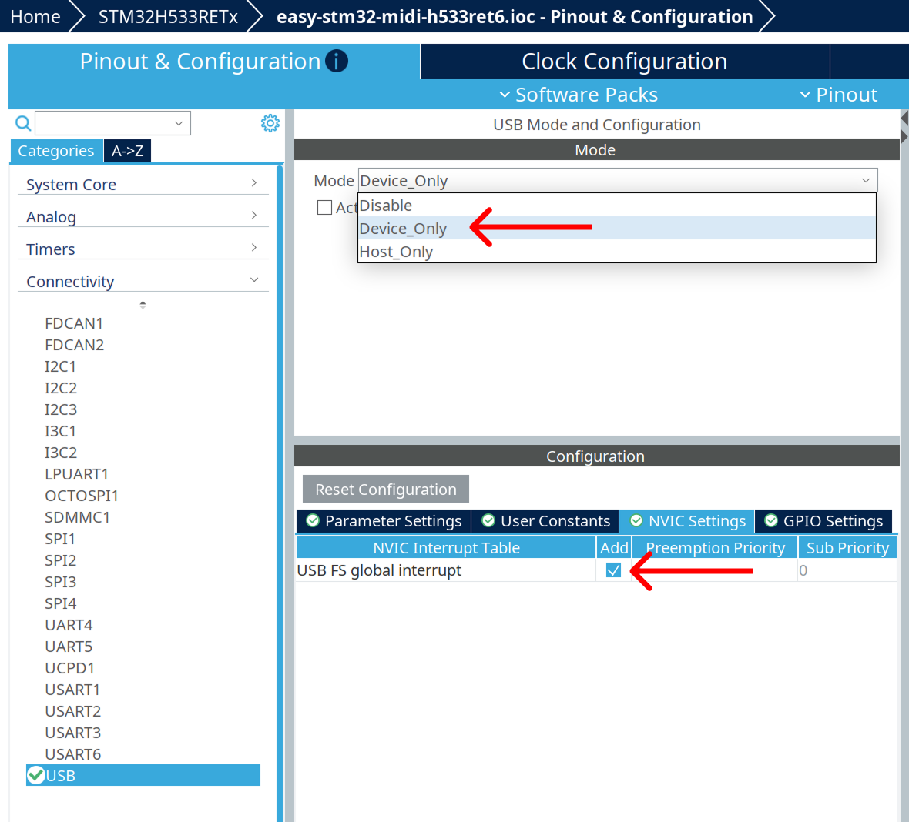

# easy-stm32-usb-midi
Easy to use USB MIDI 1.0 class driver for STM32 microcontrollers.

## Setup 
 
In STM32Cube project configurator:
- At `USB` -> Enable USB and NVIC interrupts.
(Name may differ across MCU families)

<a href="MxProject.png">
  
</a>
 
- Add [`easy-usb-midi.h`](easy-usb-midi.h) to your project.

- In your generated project initialize USB MIDI device

```c
// Name of handle vary across families
extern PCD_HandleTypeDef hpcd_USB_DRD_FS;

USBD_MIDI_HandleTypeDef hmidi;

// Make sure to initialize USB peripherial before calling this function
init_midi_device(&hmidi, &hpcd_USB_DRD_FS);
```

After this steps you are ready to send and receive MIDI messages.
#### Sending

Send MIDI messages with:
```c
USBD_StatusTypeDef send_midi_message(
	USBD_MIDI_HandleTypeDef *hmidi,const MIDI_Message *message)
```

Examples: 
```c
// Send note on message
MIDI_Message message = {
	.type = MIDI_NOTE_ON,
    .data.note = {.note = 50, .velocity = 123},
    .channel = 0
};
send_midi_message(&hmidi, &message);

// Select song
MIDI_Message message = {
    .type = MIDI_SONG_SELECT, 
    .data.songSelect = {.song = 0}, 
};
send_midi_message(&hmidi, &message);

// Change program
MIDI_Message message = {
	.type = MIDI_PROGRAM_CHANGE,
    .data.program = {.program = 1},
    .channel = 0
};
send_midi_message(&hmidi, &message);
```

For all remaining message types refer to [`easy-usb-midi.h`](easy-usb-midi.h).

**WARNING!** send_midi_message is non-blocking and doesn't provide any message queue mechanism. Simplest way to enforce reliable delivery is to spin until the message is delivered. 

```c
while (hmidi.midi_state != MIDI_IDLE) {}
send_midi_message(&hmidi, &message);
```

It's probably enough for simple setups. However, it will block indefinitely if host doesn't poll the USB bus. Queuing is recommended for more sophisticated setups.
#### Receiving

To receive midi messages, override this function with your application logic:
```c
void on_midi_message(uint8_t cable, const MIDI_Message *message);
```

#### (Optional) Device configuration
Configure MIDI device to your liking using
 ```c USBD_MIDI_InitDescriptors(&hmidi, &usb_midi_cfg);```.

Descriptors must be initialized before midi device to take an effect.

Default descriptors have following values:
```c
const USB_DeviceConfig_t usb_midi_cfg = {
    .vendor_id = 0x1209,          // 16-bit Vendor ID
    .product_id = 0x5678,         // 16-bit Product ID
    .manufacturer = "Neo",        // Manufacturer String
    .product = "Neo Synthesizer", // Product String (displayed in DAW/OS)
    .serial = "0001",             // Serial Number String
    .lang_id = 0x0409             // 0x0409= English (United States)
};
```

#### (Optional) Multi port support 

In [`easy-usb-midi.h`](easy-usb-midi.h), increase the number of ports:
```c
#define MIDI_IN_PORTS_NUM 0x01  // input ports number
#define MIDI_OUT_PORTS_NUM 0x01 // output ports number
```

Customize each port name with:
```c
const USB_DeviceConfig_t usb_midi_cfg = {
	...
	.port_names = {"Keys", "Drum Pads", "Something"}, // per-port jack names
};
```

By default `send_midi_message()` transmits messages to cable 0. Send messages to specific port with: 
```c
USBD_StatusTypeDef send_midi_message_to(
	USBD_MIDI_HandleTypeDef *hmidi,
    const MIDI_Message *message,
    uint8_t cable)
```

#### Compatibility 

Library was tested on:
- STM32H5
- STM32F4
- STM32G4
- STM32L4
- STM32F1
  
Contact: nectan@nectan.co
